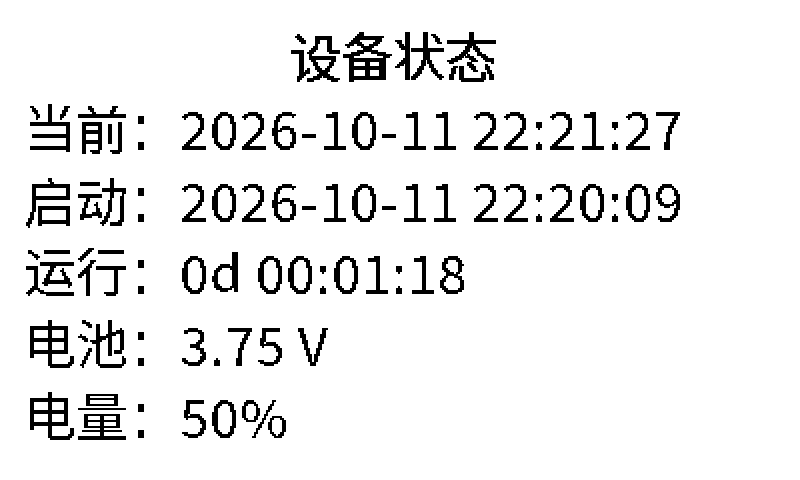
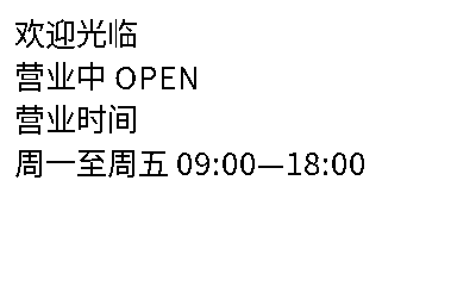

# RP2350 六色墨水屏排程指示牌

在 Waveshare **PhotoPainter (B)** 的 Pico 2 主控上运行 **MicroPython**。从 TF 卡读取类似 cron 的排程，用图片或 UTF-8 TXT 替代 cron 命令。使用产品已有电池和 PCF85063 RTC 定时唤醒；完成更新后关闭主控，墨水屏保持画面。

用户已在实机确认基本显示、RTC 校时和电池定时循环刷新，USB 日志确认了文本缓存命中、NEXT 状态页及 60 秒恢复流程。程序通过云端单元测试及 MicroPython v1.26.0 Unix 验证，新五行大字布局、Markdown 色彩和 NEXT 电池唤醒继续实测。从[部署与实机验证](docs/deployment.md)开始，硬件来源见[产品分析](docs/product-analysis.md)。

## 排程格式

```cron
# 分 时 日 月 周  TF卡路径
0 9 * * 1-5 /text/open.txt
0 18 * * 1-5 /text/closed.txt
0 0 * * 6,0 /pic/weekend.e6
*/30 9-17 * * 1-5 /pic/notice.bmp
0 12 * * * /text/notice.md
```

- 分钟 `0..59`、小时 `0..23`、日期 `1..31`、月份 `1..12`、星期 `0..7`（0 和 7 都是周日）。支持 `*`、列表 `1,3,5`、范围 `1-5`、步长 `*/15` / `9-17/2`。
- 仅数字字段，没有秒、年份、`@daily`、名称、环境变量或命令执行。路径相对 TF 根目录，支持空格和中文文件名；不支持引号转义、行尾注释及 `..`，支持全行 `#` 注释。
- 日期和星期都受限制时使用标准 cron 的 **OR**；任一字段以 `*` 开头时用 **AND**。`0 9 1 * 1` 表示每月 1 日或周一，`0 9 * * 1` 表示周一。
- “最近事件决定当前内容”：画面保持到下一条事件，重启查找最近一次匹配，不把错过的全部事件逐一重放。
- 同分钟冲突时最后一行优先。过去/未来查找上限 8 年，RTC 范围 2000..2099 年；无历史事件时使用默认内容或保留旧画面。
- 文件内容和显示配置一致就跳过刷新，即使新事件再次指定同一内容。卡片修改在下一次唤醒/分钟检查时读取，不会主动唤醒已关机的主控。

## TF 卡示例

将 `examples/tf-card/` 内容复制到 FAT32 卡根目录：

```text
schedule.cron
config.json
fonts/sign.e6f
text/default.txt
text/open.txt
text/closed.txt
text/weekend.txt
text/notice.md
pic/weekend.e6
```

示例素材已包含。程序生成 `.display-state.json` 记录成功显示的内容，不要复制其他设备的状态文件到卡上。临时状态页会先标记需要恢复，避免断电后误认为正常内容仍在屏幕上。JSON 文件统一使用 4 个空格缩进。

`config.json` 可调整字体、默认内容、文本缩放、边距、颜色、180° 方向补偿与中间唤醒间隔。`default: null` 表示没有历史事件时保留画面。颜色编码：黑 0、白 1、黄 2、红 3、蓝 5、绿 6。

## 图片与中文文本

- 直接图片：**800×480、未压缩、24 位 BMP**，支持正/负高度行方向和标准行填充。非六色 RGB 映射到最近六色，不在主控进行照片抖动。
- 推荐图片：`.e6`，16 字节 `E6P1` 头加 192,000 字节打包像素，两个像素一字节，比 BMP 更省读取和转换时间。
- PNG/JPEG 先在电脑转换；Pico 不运行 Pillow。素材工具不替代主控端排程、TXT 排版及屏幕驱动。
- TXT 为 UTF-8，最多 8192 字节；支持换行、横向自动换行，制表符当 4 个空格。超出一屏或字体缺字会报错并保留原画面，不静默丢字。
- 默认 32×32 点阵字体，含 ASCII、基本中日韩统一表意文字、常用标点与全角符号（21,256 字形，约 2.8 MB）。字库按需读取，不整套载入内存。生僻字/扩展区字符需用覆盖对应字符的原始字体重新生成。

TXT 和 Markdown 第一次显示时，设备在**源文件同一目录**生成最终像素缓存，例如 `text/open.txt.e6cache`、`text/notice.md.e6cache`，每份 192,076 字节，含方向补偿和校验信息。此后直接读取打包像素，不查字库、不排版、不旋转，也不再逐次扫描整个字库。修改源文件内容、文字设置、方向或字库路径/大小/修改时间会重建；缓存损坏、缺失或写入中断时重新生成。源文本始终保留，缓存写入失败仍尝试显示。

字库更新用文件大小与修改时间识别；替换字库时若保留了相同大小与时间戳，请删除对应 `.e6cache` 强制重建。缓存是本程序内部格式，cron 仍指向 `.txt` / `.md` 源文件。

## 简单 Markdown 与文字颜色

使用 UTF-8 `.md` 文件，cron 中直接写文件路径：

```markdown
# <span style="color: red">营业通知</span>

欢迎光临
## 今日安排
**营业时间：**09:00—18:00
<span style="color: blue">请从右侧入口进入</span>
```

`#` 标题居中、比正文大一级；`##` 标题居中、与正文同字号；标题和 `**粗体**` 使用点阵加粗。每个源文本行换行，空行增加段落间距，过长自动折行，标题折行后仍居中。颜色支持 `black`、`white`、`yellow`、`red`、`blue`、`green`；白字需配合深色背景。`<span>` 与 `**` 必须在同一源行闭合，反斜杠可转义 `*`、`<`、反斜杠。支持的是这些排版语法，不包含表格、图片嵌入或完整 HTML/CSS。

普通 `.txt` 保持原样显示。统一文字颜色也可通过 `config.json` 的 `text.foreground` 设置，例如 `3` 表示红字。


## NEXT 临时状态页

按 NEXT（官方示例的 GP19 低电平按键）保留居中的“设备状态”标题，下方以默认 **64 像素字高**显示五行：当前、启动、运行、电池、电量，保留完整日期时间，省去“约”和恢复提示。状态页刷新完成后等待 **60 秒**，再恢复那时最新的排程；期间再按 NEXT 会重新采样并重新计时。`status_seconds` 默认 `60`，范围 `1..600`。屏幕正在刷新时，按键先记录，刷新完成后处理。

电池关机期间按键唤醒会重新启动主控，所以启动时间和运行时长按**本次上电**计算；状态页的时间为采样值。没有 RTC 闹钟标志的电池启动按手动唤醒处理。状态页等待期间保持主控供电，恢复正常画面后重新安排 RTC 并关机。电量使用单节锂电池电压曲线粗估，受负载、充电和温度影响，并非精确电量计。



## 调试与长期日志

`config.json` 的 `logging` 设置可修改，例如：

```json
{
    "logging": {
        "debug": true,
        "warnings": true,
        "directory": "/logs",
        "max_bytes": 65536,
        "backup_count": 3
    }
}
```

把其中的 `logging` 对象合入现有配置，示例完整文件见 [config.json](examples/tf-card/config.json)。默认 `debug: false`、`warnings: true`：警告与异常保存到 `/logs/warnings.log`；打开调试后所有级别同时保存到 `/logs/debug.log`，包含缓存、各阶段耗时、启动、电压及 RTC 唤醒安排。异常附带堆栈；串口与文件记录均带当地 RTC 时间和级别，例如 `[2026-10-11 21:30:00] [DEBUG] [timing] text_cache: 123 ms`。RTC 无效时使用 `uptime_ms`；挂卡前的输出仅在串口。

每类日志达到 `max_bytes` 后轮转为 `.log.1` 等，默认最多当前文件加 3 份备份，每类最多 256 KiB；设置 `warnings: false` 可关闭长期日志。单条记录过大时截断，文件写入后关闭并同步；日志 I/O 失败会在串口报告，并继续运行应用。详细调试会增加写卡和耗电，长期电池运行建议关闭 `debug`。ACT 覆盖内容处理和屏幕刷新，不能用它判断主控是否一直运行。

开发电脑安装 `requirements-dev.txt` 后：

```sh
# 检查当前与下一事件
python tools/check_schedule.py examples/tf-card/schedule.cron --at 2026-10-11T12:00:00
# 照片可增加 --dither；标识和文字通常不用
python tools/prepare_image.py photo.jpg notice.e6
python tools/prepare_image.py photo.jpg notice.bmp --dither
# 与设备相同的文字排版预览
python tools/render_preview.py examples/tf-card /text/open.txt open-preview.png
python tools/render_preview.py examples/tf-card /text/notice.md notice-preview.png
# 从合法使用的字体生成所需字形，可缩小字库
python tools/make_font.py font.ttf sign.e6f text1.txt text2.txt
# 本仓库示例字库生成方式，TTC 第 2 号为简体中文面
python tools/make_font.py /usr/share/fonts/opentype/noto/NotoSansCJK-Regular.ttc sign.e6f --font-index 2 --cjk
```

`text.scale` 默认 2，长文本可改为 1。默认白底黑字、左对齐、24 px 边距。
`make_font.py` 还会自动加入 NEXT 状态页所需文字；已有自制小字库需重新生成一次。



## 程序与验证

`firmware/` 全部 Python 文件上传到主控内部闪存，示例内容放 TF 卡。使用 `tools/deploy.py` 上传，`tools/set_time.py` 校准外部 RTC，再重启；完整步骤与恢复方法见[部署文档](docs/deployment.md)。

```sh
python -m unittest discover -s tests -v
```

覆盖 cron、RTC、BUSY/SPI、图片与字体、像素缓存复用/损坏/失效、Markdown 六色排版、日志轮转/堆栈、NEXT 防抖、60 秒恢复最新排程及电池关机。独立 MicroPython 验证脚本是 `tests/micropython_smoke.py`，须提供可写的 TF 卡副本，不在真实卡上运行。该脚本已在 **320 KiB Unix MicroPython 堆**限制下通过，包含 Markdown、状态页和日志；这验证了缓冲复用与语言兼容，不能代替 RP2350 实测。

电池模式最多每 6 小时检查远期事件，以应对 RTC 没有月/年比较字段。实机耗电和刷新速度待测，不承诺官方相框固件的同等续航或秒级切换。

第三方驱动及字体说明见 [licenses/](licenses/README.md)。
